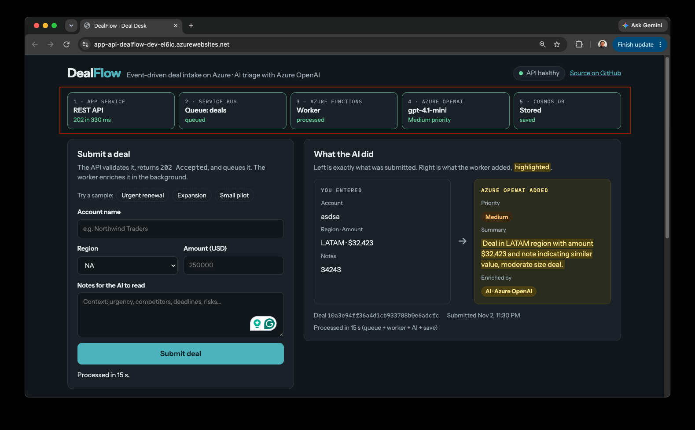
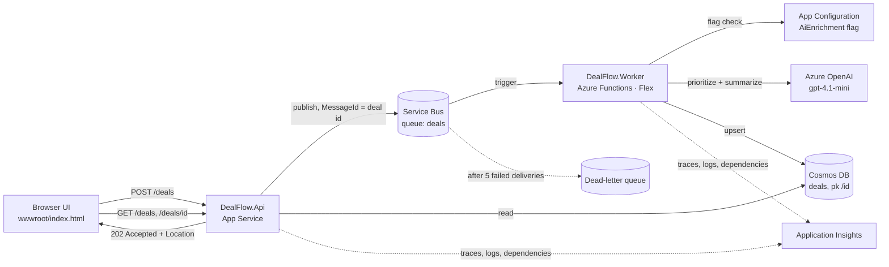
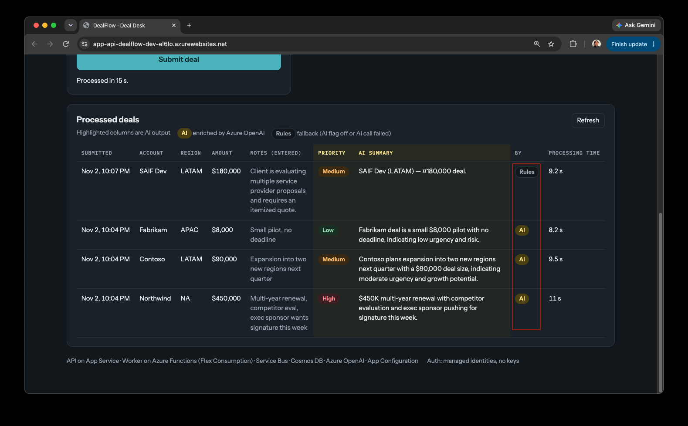
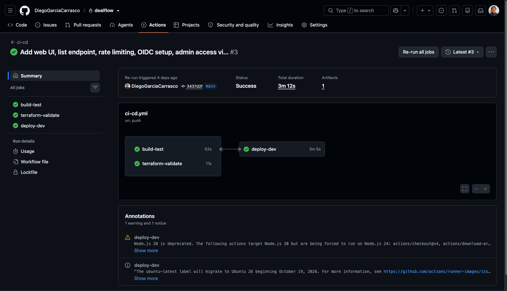
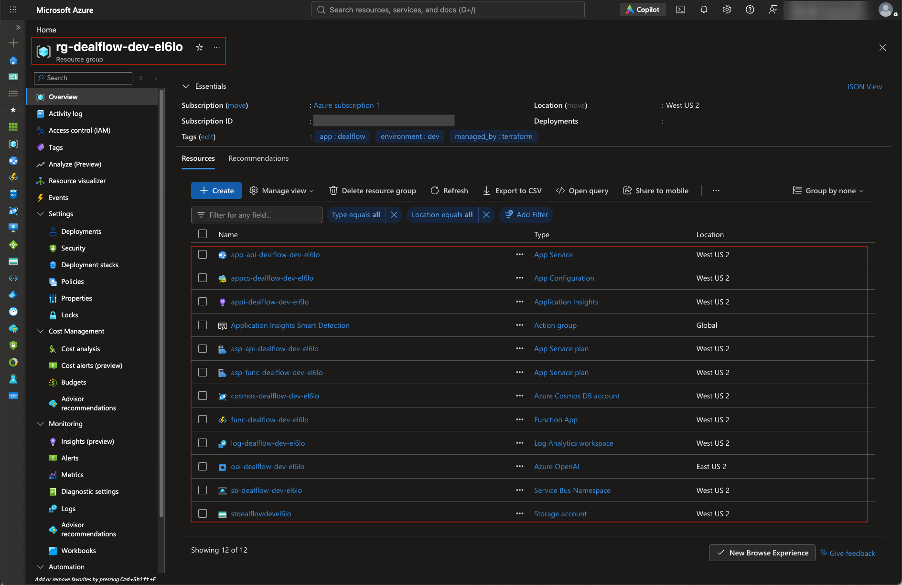
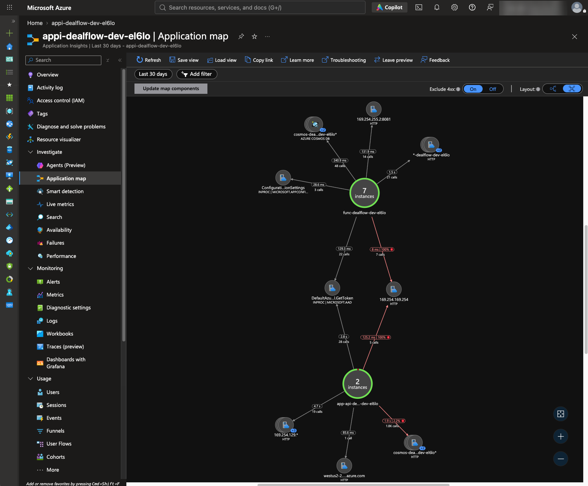
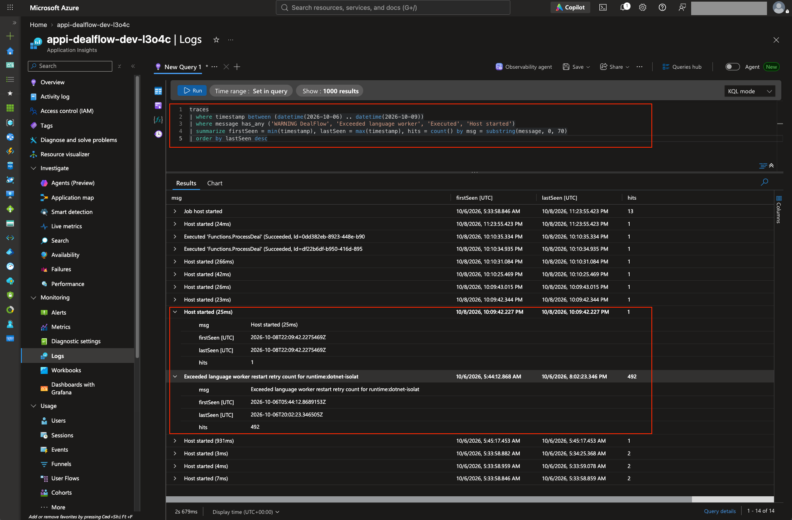

# DealFlow

An event-driven deal-intake service on Azure. A web UI and REST API accept sales deals, a Service Bus queue decouples intake from processing, and an Azure Functions worker prioritizes and summarizes each deal with Azure OpenAI before storing it in Cosmos DB.

Built with C# / .NET 8, provisioned with Terraform, deployed by GitHub Actions over OIDC, and authenticated end-to-end with managed identities — no keys, connection strings, or stored pipeline credentials.

📖 **[How this was built](docs/build-story.md)**: design → first deploy → live-site incident → CI/CD → web UI, with screenshots of every step.



## Try it
Open the API's URL in a browser (`terraform -chdir=infra output -raw api_url`). The UI is served by the API itself:
- **Submit a deal** (or pick a sample) and watch it move through the pipeline strip: API → Service Bus → Worker → Azure OpenAI → Cosmos DB.
- **What the AI did** shows the deal exactly as entered next to what the worker added — priority and summary, highlighted.
- **Processed deals** lists recent deals, marking whether each was enriched by Azure OpenAI or by the rules fallback, and how long processing took.
- Submit an empty form to see server-side validation errors returned as RFC 7807 problem details.

## Architecture



**Request flow (async request-reply):**
1. `POST /deals` validates input, assigns an id, publishes to Service Bus, and returns `202 Accepted` with a `Location` header.
2. The worker receives the message, skips it if the deal was already processed (idempotency), enriches it, and upserts it to Cosmos DB.
3. `GET /deals/{id}` returns `404` until processing finishes, then the enriched deal. `GET /deals?limit=20` lists recent processed deals for the UI.

| Endpoint | Purpose |
|---|---|
| `GET /` | Web UI (static file served by the API — same origin, no CORS) |
| `GET /health` | Liveness for App Service health checks and the pipeline |
| `POST /deals` | Validate and queue a deal → `202`, `400` (validation), `429` (rate limit) |
| `GET /deals/{id}` | One deal → `200` or `404` while processing |
| `GET /deals?limit=N` | Recent processed deals, newest first (max 50) |

## Design decisions
| Record | Decision |
|---|---|
| [ADR 0001](docs/adr/0001-service-bus-for-deal-handoff.md) | Service Bus over Storage Queues / Event Hubs, for dead-lettering and duplicate detection |
| [ADR 0002](docs/adr/0002-cosmos-partitioning.md) | Cosmos DB serverless partitioned by `/id` for cheap point reads |
| [ADR 0003](docs/adr/0003-ai-enrichment-feature-flag.md) | LLM enrichment behind a runtime feature flag, with validation and a rules fallback |
| [Postmortem](docs/postmortem-worker-crash-loop.md) | Live-site incident: worker crash loop from an SDK major-version conflict, and what changed |
| [Build story](docs/build-story.md) | The whole project, phase by phase, including every problem hit along the way |

## Reliability and security
- **At-least-once delivery handled:** broker duplicate detection plus an idempotent processor.
- **Poison messages** go to the dead-letter queue after 5 attempts instead of blocking the queue.
- **Graceful degradation:** if Azure OpenAI throttles or returns bad output, deals are still processed by rules, and `enrichedBy` records which path ran. A feature-flag store outage can't crash the worker either.
- **Safe rollout:** the `AiEnrichment` flag can be flipped or percentage-rolled at runtime from App Configuration.
- **Cost and abuse control:** `POST /deals` is rate-limited per client IP (10/min → `429`), because each accepted deal costs an Azure OpenAI call.
- **Zero secrets:** local auth is disabled on Service Bus, Cosmos DB, Azure OpenAI, and App Configuration; each app's managed identity gets only the roles it needs. GitHub Actions signs in to Azure with OIDC federation — no stored credentials.
- **Verified deployments:** the pipeline fails unless the worker registers its trigger and an end-to-end smoke test passes.
- **Untrusted input and output:** the UI renders user text with `textContent` only (no HTML injection); model output is schema-validated before it's stored.

## Screenshots
| | |
|---|---|
|  |  |
| Input vs AI output, live pipeline | History: AI vs rules fallback, processing time |
|  |  |
| GitHub Actions: build → test → Terraform → deploy → verify | Everything Terraform created |
|  |  |
| Application Insights: the whole distributed flow | Postmortem evidence: crash loop and recovery |

The full set (30 screenshots, in the order things were built and fixed) is in the **[build story](docs/build-story.md)**.

## Repository layout
```
src/DealFlow.Core           Domain model, validation, DealProcessor, Cosmos repository
src/DealFlow.Api            Minimal API, Service Bus publisher, rate limiting
src/DealFlow.Api/wwwroot    Web UI (single static page, no build step)
src/DealFlow.Worker         Azure Functions (isolated) trigger, Azure OpenAI enricher, feature flags
tests/DealFlow.Tests        xUnit unit tests + in-memory API integration tests
infra/                      Terraform (azurerm 4.x) with remote state in Azure Storage
scripts/                    OIDC setup for GitHub Actions, end-to-end smoke test
docs/                       ADRs, build story, postmortem, screenshots
```

## Run the tests
```bash
dotnet test
```
19 tests cover validation, rule thresholds, AI output parsing, every processor branch (AI on/off, AI failure fallback, duplicate delivery), and the API via `WebApplicationFactory` (status codes, list ordering, rate limiting, UI served) with Service Bus and Cosmos replaced by in-memory fakes.

## Deploy

### With GitHub Actions (recommended)
Every push to `main` runs `.github/workflows/ci-cd.yml`: build and test → Terraform validate → `terraform apply` → deploy API and worker → verify the worker registered → end-to-end smoke test.

One-time setup:
1. Create the Terraform state storage (resource group, storage account, `tfstate` container) and `infra/backend.hcl` from the example.
2. Run, signed in with `az login`:
   ```bash
   ./scripts/setup-github-oidc.sh <owner>/dealflow <tfstate-rg> <tfstate-account>
   ```
   It creates an app registration trusted only by this repo's `dev` environment (OIDC federated credential) and grants its roles.
3. In GitHub, create the `dev` environment, then add the secrets and variables the script prints. Azure IDs go in **secrets** so they're masked in the public Actions logs.
4. In GitHub → Settings → Environments → `dev`, limit deployments to the `main` branch.
5. Push to `main`.

Optional: set the repository secret `ADMIN_OBJECT_ID`, and the same value in a gitignored `infra/admin.auto.tfvars` for local runs (see the `.example`). Every deploy then grants that user data access for the portal's Cosmos Data Explorer, Service Bus Explorer, and OpenAI playground. Subscription Owner alone isn't enough, because key auth is disabled.

### Manually
```bash
cd infra && terraform init -backend-config=backend.hcl && terraform apply && cd ..
dotnet publish src/DealFlow.Api -c Release -o out/api && (cd out/api && zip -qr ../api.zip .)
dotnet publish src/DealFlow.Worker -c Release -o out/worker && (cd out/worker && zip -qr ../worker.zip .)
RG=$(terraform -chdir=infra output -raw resource_group)
az webapp deploy -g $RG -n $(terraform -chdir=infra output -raw api_app_name) --src-path out/api.zip --type zip
FUNC=$(terraform -chdir=infra output -raw function_app_name)
az functionapp deployment source config-zip -g $RG -n $FUNC --src out/worker.zip
az functionapp keys list -g $RG -n $FUNC > /dev/null   # wake the host so it loads the new package
./scripts/smoke-test.sh
```

Turn AI enrichment off without redeploying:
```bash
az appconfig feature disable --name <app-configuration-name> --feature AiEnrichment --auth-mode login
```

## Running the worker locally
Copy `src/DealFlow.Worker/local.settings.json.example` to `local.settings.json`, point it at your deployed resources, grant your own user the same data-plane roles the worker identity has, and run `func start` (Azure Functions Core Tools v4).

## How I used AI tools
<!-- Write this section yourself, honestly: what you used (e.g., Copilot, Claude), for what,
     what you changed or rejected after review, and what you verified by hand. -->

## What I'd do next
- Alert on dead-letter queue depth and on the AI fallback rate
- A replay tool for dead-lettered messages
- Change feed → projection container for reporting queries (replaces the cross-partition list query)
- Load test the API and measure worker throughput vs. `maxConcurrentCalls`