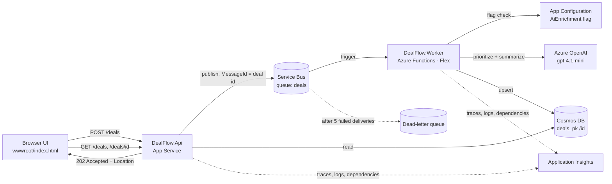

# DealFlow

**[README](README.md)** · [How it was built](docs/build-story.md) · [Incident postmortem](docs/postmortem-worker-crash-loop.md)

An event-driven deal-intake service on Azure. A web UI and REST API accept sales deals, a Service Bus queue separates intake from processing, and an Azure Functions worker prioritizes and summarizes each deal with Azure OpenAI before storing it in Cosmos DB.

Built with C# / .NET 8, provisioned with Terraform, deployed by GitHub Actions over OIDC, and authenticated end to end with managed identities: no keys, connection strings, or stored pipeline credentials.

> **In plain terms:** a salesperson types in a new deal. The app answers right away ("got it"), then in the background an AI reads the deal, decides how urgent it is, writes a one-line summary, and saves it. If the AI is slow or unavailable, simple rules take over, so no deal is ever lost.

<br>

<p align="center">
  
  <br>
  <sub><b>The finished app.</b> Left: the deal exactly as typed. Right: the priority and summary Azure OpenAI added.</sub>
</p>

<br>

📖 **Want the full story?** [How this was built](docs/build-story.md) walks through every phase (design, first deploy, a real outage, CI/CD, web UI) with screenshots of each step.

---

## Contents
1. [Try it](#try-it)
2. [Architecture](#architecture)
3. [Design decisions](#design-decisions)
4. [Reliability and security](#reliability-and-security)
5. [Screenshots](#screenshots)
6. [Glossary](#glossary)
7. [Repository layout](#repository-layout)
8. [Run the tests](#run-the-tests)
9. [Deploy](#deploy)
10. [How I used AI tools](#how-i-used-ai-tools)
11. [What I'd do next](#what-id-do-next)

---

## Try it
Open the API's URL in a browser (`terraform -chdir=infra output -raw api_url`). The UI is served by the API itself.

- **Submit a deal** (or pick a sample) and watch it move through the pipeline strip: API → Service Bus → Worker → Azure OpenAI → Cosmos DB.
- **What the AI did** shows the deal exactly as entered next to what the worker added (priority and summary, highlighted).
- **Processed deals** lists recent deals, marking whether each was enriched by Azure OpenAI or by the rules fallback, and how long processing took.
- **Submit an empty form** to see server-side validation errors, returned as RFC 7807 problem details.

---

## Architecture



> **In plain terms:** the front desk (API) takes the deal and drops it in an inbox (Service Bus). A back-office worker (Azure Functions) picks it up, asks the AI for a priority and summary, and files it in the database (Cosmos DB). Everything is monitored (Application Insights).

**Request flow (async request-reply):**
1. `POST /deals` validates input, assigns an id, publishes to Service Bus, and returns `202 Accepted` with a `Location` header.
2. The worker receives the message, skips it if the deal was already processed (idempotency), enriches it, and upserts it to Cosmos DB.
3. `GET /deals/{id}` returns `404` until processing finishes, then the enriched deal. `GET /deals?limit=20` lists recent processed deals for the UI.

| Endpoint | Purpose |
|---|---|
| `GET /` | Web UI (static file served by the API: same origin, no CORS) |
| `GET /health` | Liveness for App Service health checks and the pipeline |
| `POST /deals` | Validate and queue a deal → `202`, `400` (validation), `429` (rate limit) |
| `GET /deals/{id}` | One deal → `200`, or `404` while processing |
| `GET /deals?limit=N` | Recent processed deals, newest first (max 50) |

---

## Design decisions
| Record | Decision |
|---|---|
| [ADR 0001](docs/adr/0001-service-bus-for-deal-handoff.md) | Service Bus over Storage Queues / Event Hubs, for dead-lettering and duplicate detection |
| [ADR 0002](docs/adr/0002-cosmos-partitioning.md) | Cosmos DB serverless partitioned by `/id` for cheap point reads |
| [ADR 0003](docs/adr/0003-ai-enrichment-feature-flag.md) | LLM enrichment behind a runtime feature flag, with validation and a rules fallback |
| [Postmortem](docs/postmortem-worker-crash-loop.md) | Live-site incident: worker crash loop from an SDK major-version conflict, and what changed |
| [Build story](docs/build-story.md) | The whole project, phase by phase, including every problem hit along the way |

---

## Reliability and security
- **At-least-once delivery handled:** broker duplicate detection plus an idempotent processor, so a deal is never processed twice.
- **Poison messages** go to the dead-letter queue after 5 attempts instead of blocking the queue.
- **Graceful degradation:** if Azure OpenAI throttles or returns bad output, deals are still processed by rules, and `enrichedBy` records which path ran. A feature-flag store outage can't crash the worker either.
- **Safe rollout:** the `AiEnrichment` flag can be flipped or percentage-rolled at runtime from App Configuration, with no redeploy.
- **Cost and abuse control:** `POST /deals` is rate-limited per client IP (10/min → `429`), because each accepted deal costs an Azure OpenAI call.
- **Zero secrets:** local auth is disabled on Service Bus, Cosmos DB, Azure OpenAI, and App Configuration; each app's managed identity gets only the roles it needs. GitHub Actions signs in to Azure with OIDC federation, so no credentials are stored.
- **Verified deployments:** the pipeline fails unless the worker registers its trigger and an end-to-end smoke test passes.
- **Untrusted input and output:** the UI renders user text with `textContent` only (no HTML injection); model output is schema-validated before it's stored.

---

## Screenshots
A short tour. The [build story](docs/build-story.md) has the full set, in the order things were built and fixed.

<br>

**1 · Deal history**<br>
Recent deals, whether the AI or the rules fallback handled each one, and how long it took.

<p align="center"></p>

<br>

**2 · The automated pipeline**<br>
Every push to `main`: build → test → Terraform → deploy → verify the worker → end-to-end smoke test.

<p align="center"></p>

<br>

**3 · Everything Terraform created**<br>
One resource group holds the whole service, all defined in code.

<p align="center"></p>

<br>

**4 · The system as Azure sees it**<br>
Application Insights draws the live flow: API → worker → Cosmos DB, Azure OpenAI, and App Configuration. The red edges are expected noise (identity token probes, and Cosmos `404`s while a deal is still processing).

<p align="center"></p>

<br>

**5 · A real outage, diagnosed**<br>
The worker crashed 492 times before the fix; then the host started and the two waiting deals were processed. Full write-up in the [postmortem](docs/postmortem-worker-crash-loop.md).

<p align="center"></p>

---

## Glossary
For readers who don't work with Azure every day.

| Term | What it means here |
|---|---|
| **API** | The "front desk": the web address the UI and other programs send deals to. |
| **Service Bus queue** | An inbox that holds deals until the worker is ready, so nothing is lost if the worker is down. |
| **Dead-letter queue** | A side inbox for messages that failed 5 times, kept for inspection instead of blocking everything else. |
| **Azure Functions worker** | Code that wakes up when a deal arrives, processes it, and scales to zero when idle. |
| **Azure OpenAI** | The AI model (gpt-4.1-mini) that sets the priority and writes the summary. |
| **Cosmos DB** | The database where processed deals are stored. |
| **Feature flag** | An on/off switch (`AiEnrichment`) that turns the AI off instantly, without redeploying. |
| **Managed identity** | Azure's built-in identity for each app, so no passwords or keys exist in the code. |
| **OIDC** | How GitHub Actions proves who it is to Azure without a stored password. |
| **Terraform** | Code that describes all the cloud resources, so the environment can be rebuilt from scratch. |

---

## Repository layout
```
src/DealFlow.Core           Domain model, validation, DealProcessor, Cosmos repository
src/DealFlow.Api            Minimal API, Service Bus publisher, rate limiting
src/DealFlow.Api/wwwroot    Web UI (single static page, no build step)
src/DealFlow.Worker         Azure Functions (isolated) trigger, Azure OpenAI enricher, feature flags
tests/DealFlow.Tests        xUnit unit tests + in-memory API integration tests
infra/                      Terraform (azurerm 4.x) with remote state in Azure Storage
scripts/                    OIDC setup for GitHub Actions, end-to-end smoke test
docs/                       ADRs, build story, postmortem, screenshots
```

---

## Run the tests
```bash
dotnet test
```
19 tests cover validation, rule thresholds, AI output parsing, every processor branch (AI on/off, AI failure fallback, duplicate delivery), and the API via `WebApplicationFactory` (status codes, list ordering, rate limiting, UI served), with Service Bus and Cosmos replaced by in-memory fakes.

---

## Deploy

### With GitHub Actions (recommended)
Every push to `main` runs `.github/workflows/ci-cd.yml`: build and test → Terraform validate → `terraform apply` → deploy API and worker → verify the worker registered → end-to-end smoke test.

One-time setup:
1. Create the Terraform state storage (resource group, storage account, `tfstate` container) and `infra/backend.hcl` from the example.
2. Run, signed in with `az login`:
   ```bash
   ./scripts/setup-github-oidc.sh <owner>/dealflow <tfstate-rg> <tfstate-account>
   ```
   It creates an app registration trusted only by this repo's `dev` environment (OIDC federated credential) and grants its roles.
3. In GitHub, create the `dev` environment, then add the secrets and variables the script prints. Azure IDs go in **secrets** so they're masked in the public Actions logs.
4. In GitHub → Settings → Environments → `dev`, limit deployments to the `main` branch.
5. Push to `main`.

Optional: set the repository secret `ADMIN_OBJECT_ID`, and the same value in a gitignored `infra/admin.auto.tfvars` for local runs (see the `.example`). Every deploy then grants that user data access for the portal's Cosmos Data Explorer, Service Bus Explorer, App Configuration, and OpenAI playground. Subscription Owner alone isn't enough, because key auth is disabled.

### Manually
```bash
cd infra && terraform init -backend-config=backend.hcl && terraform apply && cd ..
dotnet publish src/DealFlow.Api -c Release -o out/api && (cd out/api && zip -qr ../api.zip .)
dotnet publish src/DealFlow.Worker -c Release -o out/worker && (cd out/worker && zip -qr ../worker.zip .)
RG=$(terraform -chdir=infra output -raw resource_group)
az webapp deploy -g $RG -n $(terraform -chdir=infra output -raw api_app_name) --src-path out/api.zip --type zip
FUNC=$(terraform -chdir=infra output -raw function_app_name)
az functionapp deployment source config-zip -g $RG -n $FUNC --src out/worker.zip
az functionapp keys list -g $RG -n $FUNC > /dev/null   # wake the host so it loads the new package
./scripts/smoke-test.sh
```

Turn AI enrichment off without redeploying:
```bash
az appconfig feature disable --name <app-configuration-name> --feature AiEnrichment --auth-mode login
```

### Running the worker locally
Copy `src/DealFlow.Worker/local.settings.json.example` to `local.settings.json`, point it at your deployed resources, grant your own user the same data-plane roles the worker identity has, and run `func start` (Azure Functions Core Tools v4).

---

## How I used AI tools
I used AI assistants (Claude and GitHub Copilot) the way I'd use a fast pair programmer: to move quicker, not to make the decisions.

- **I set the direction.** I defined the goal, the scenario, and the non-negotiables: asynchronous processing, no keys anywhere, everything rebuildable from code, and every request traceable. I chose the architecture and made the trade-offs recorded in the [ADRs](#design-decisions).
- **AI sped up the build.** It produced first drafts of code, Terraform, tests, and docs. I reviewed every change, reworked what didn't fit the design, and rejected suggestions that were wrong. For example, when the pipeline failed reading Terraform state, an assistant blamed the build-test job; the logs showed a missing data-plane role, and that was the fix.
- **I owned what ran in Azure.** I deployed every version, diagnosed the [worker crash loop](docs/postmortem-worker-crash-loop.md) from queue metrics and host logs, reproduced it locally, and fixed each pipeline failure. AI could suggest where to look; proving the answer was my job.

The result: a production-style service in about a month, where I can explain the reason behind every component and every fix.

---

## What I'd do next
- Alert on dead-letter queue depth and on the AI fallback rate
- A replay tool for dead-lettered messages
- Change feed → projection container for reporting queries (replaces the cross-partition list query)
- Load test the API and measure worker throughput vs. `maxConcurrentCalls`
