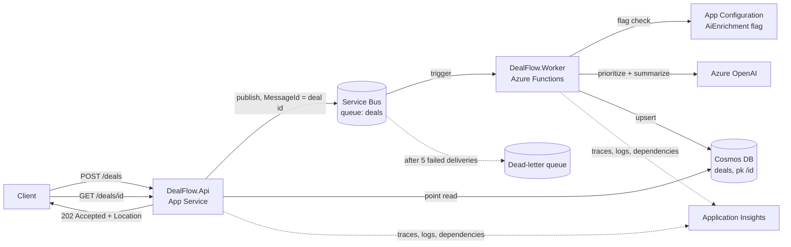

# DealFlow

An event-driven deal-intake service on Azure. A REST API accepts sales deals, a Service Bus queue decouples intake from processing, and an Azure Functions worker prioritizes and summarizes each deal with Azure OpenAI before storing it in Cosmos DB.

Built with C# / .NET 8, deployed with Terraform and GitHub Actions, and authenticated end-to-end with managed identities (no keys or connection strings).

## Architecture



**Request flow (async request-reply):**
1. `POST /deals` validates input, assigns an id, publishes to Service Bus, and returns `202 Accepted` with a `Location` header.
2. The worker receives the message, skips it if the deal was already processed (idempotency), enriches it, and upserts it to Cosmos DB.
3. `GET /deals/{id}` returns `404` until processing finishes, then the enriched deal.

## Design decisions
| ADR | Decision |
|---|---|
| [0001](docs/adr/0001-service-bus-for-deal-handoff.md) | Service Bus over Storage Queues / Event Hubs, for dead-lettering and duplicate detection |
| [0002](docs/adr/0002-cosmos-partitioning.md) | Cosmos DB serverless partitioned by `/id` for cheap point reads |
| [0003](docs/adr/0003-ai-enrichment-feature-flag.md) | LLM enrichment behind a runtime feature flag, with validation and a rules fallback |

## Reliability and security
- **At-least-once delivery handled:** broker duplicate detection plus an idempotent processor.
- **Poison messages** go to the dead-letter queue after 5 attempts instead of blocking the queue.
- **Graceful degradation:** if Azure OpenAI throttles or returns bad output, deals are still processed by rules, and `EnrichedBy` records which path ran.
- **Safe rollout:** the `AiEnrichment` flag can be flipped or percentage-rolled at runtime from App Configuration.
- **Zero secrets in app config:** local auth is disabled on Service Bus, Cosmos DB, Azure OpenAI, and App Configuration; each app's managed identity gets only the roles it needs (the API can send and read, the worker can receive and write).
- **Telemetry:** OpenTelemetry (API) and Application Insights (worker) with deal id and delivery count on every log scope.

## Repository layout
```
src/DealFlow.Core     Domain model, validation, DealProcessor, Cosmos repository
src/DealFlow.Api      Minimal API + Service Bus publisher
src/DealFlow.Worker   Azure Functions (isolated) trigger, Azure OpenAI enricher, feature flags
tests/DealFlow.Tests  xUnit unit tests + in-memory API integration tests
infra/                Terraform (azurerm 4.x) with remote state in Azure Storage
docs/adr/             Architecture decision records
```

## Run the tests
```bash
dotnet test
```
Tests cover validation, rule thresholds, AI output parsing, every processor branch (AI on/off, AI failure fallback, duplicate delivery), and the API endpoints via `WebApplicationFactory` with Service Bus and Cosmos replaced by in-memory fakes.

## Deploy
Prerequisites: an Azure subscription, a storage account for Terraform state, and an Entra app registration with a GitHub OIDC federated credential (Contributor + User Access Administrator on the subscription, or scoped to a resource group).

```bash
cd infra
cp backend.hcl.example backend.hcl   # fill in your state storage account
az login
terraform init -backend-config=backend.hcl
terraform apply
```

Then publish the apps, or push to `main` and let `.github/workflows/ci-cd.yml` build, test, apply Terraform, deploy both apps, and smoke-test `/health`. Set repo variables `AZURE_CLIENT_ID`, `AZURE_TENANT_ID`, `AZURE_SUBSCRIPTION_ID`, `TFSTATE_RG`, and `TFSTATE_ACCOUNT`.

Try it:
```bash
curl -i -X POST "$API_URL/deals" -H "Content-Type: application/json" \
  -d '{"accountName":"Contoso","region":"NA","amountUsd":180000,"notes":"Renewal plus Copilot expansion, decision by Friday"}'
# follow the Location header
curl "$API_URL/deals/<id>"
```

Turn AI enrichment off without redeploying:
```bash
az appconfig feature disable --name <app-configuration-name> --feature AiEnrichment --auth-mode login
```

## Running the worker locally
Copy `src/DealFlow.Worker/local.settings.json.example` to `local.settings.json`, point it at your deployed resources, grant your own user the same data-plane roles the worker identity has, and run `func start` (Azure Functions Core Tools v4).

## How I used AI tools
<!-- Write this section yourself, honestly: what you used (e.g., Copilot, Claude), for what,
     what you changed or rejected after review, and what you verified by hand. -->

## What I'd do next
- Alert on dead-letter queue depth and on the AI fallback rate
- A replay tool for dead-lettered messages
- Change feed → projection container for "deals by region/priority" queries
- Load test the API and measure worker throughput vs. `maxConcurrentCalls`
