# How DealFlow was built

[README](../README.md) · **[How it was built](build-story.md)** · [Incident postmortem](postmortem-worker-crash-loop.md)

DealFlow went from an idea to a CI/CD-deployed, AI-enriched, event-driven service on Azure. This page tells that story in order, including the problems hit along the way, because the fixes say more about the engineering than the happy path does.

> **How to read this page:** each phase starts with a short **In plain terms** summary for non-technical readers, followed by the technical detail. Every screenshot is a numbered figure with a one-line caption explaining what it proves.

**Contents**
1. [Why this project](#1-why-this-project)
2. [Design before code](#2-design-before-code)
3. [Code, inside out](#3-code-inside-out)
4. [First manual deploy](#4-first-manual-deploy)
5. [The incident](#5-the-incident)
6. [Understand and verify](#6-understand-and-verify)
7. [CI/CD with OIDC](#7-cicd-with-oidc)
8. [Web UI](#8-web-ui)
9. [Public-repo hardening](#9-public-repo-hardening)
10. [The result](#10-the-result)

---

## 1. Why this project

> **In plain terms:** I wanted to show, with a real running system, how a modern cloud application stays fast and reliable even when the work behind it is slow or something fails.

With DealFlow I wanted to show an **application side, end to end**: how a scalable, asynchronous, event-driven backend behaves in production. That means:

- **Responsive APIs** that answer in milliseconds while the slow work happens in the background (async request-reply).
- **Message-based decoupling** with Service Bus, so intake keeps working even when processing is down.
- **A serverless worker** that scales out under load and back to zero when idle.
- **Durable, idempotent processing** into Cosmos DB, so every deal is processed exactly once.
- **AI integration done safely:** validated model output, a rules fallback, and a feature flag to switch it off at runtime.
- **Observability** that traces a single request across every service.

I built it the way a production service is built, not as a localhost demo: provisioned entirely with Terraform, deployed through CI/CD, secured without a single key or stored credential, and operated through a real incident.

---

## 2. Design before code

> **In plain terms:** before writing code I picked a realistic business scenario, chose the building blocks, and wrote down why.

- **Scenario:** sales deal intake with AI triage, so the project reads as a product, not a tutorial.
- **Pattern:** async request-reply. The API accepts fast and returns `202`; a worker does the slow AI and database work; the client polls.
- **Decisions recorded as ADRs:**
  - [0001](adr/0001-service-bus-for-deal-handoff.md): Service Bus over Storage Queues and Event Hubs, for dead-lettering and duplicate detection.
  - [0002](adr/0002-cosmos-partitioning.md): Cosmos DB serverless, partitioned by `/id` for cheap point reads.
  - [0003](adr/0003-ai-enrichment-feature-flag.md): Azure OpenAI behind a runtime feature flag, with output validation and a rules fallback.
- **Security baseline from day one:** managed identities everywhere and local/key auth disabled on every service.

---

## 3. Code, inside out

> **In plain terms:** I built and tested the business logic first, then connected it to Azure, so most of the code can be checked without the cloud.

The order was deliberate: business logic first, Azure at the edges.

1. **Core domain** (`src/DealFlow.Core`): `Deal`, validation, interfaces, then `DealProcessor` (idempotency check → AI or rules → save), with unit tests. No Azure SDK involved, so every branch is testable in memory.
2. **API** (`src/DealFlow.Api`): ASP.NET Core minimal API on top of Core, publishing to Service Bus.
3. **Worker** (`src/DealFlow.Worker`): Azure Functions isolated worker with a Service Bus trigger and the Azure OpenAI enricher (strict JSON, temperature 0, schema validation, prompt-injection mitigation).
4. **Infrastructure** (`infra/`): Terraform for ~25 resources plus least-privilege role assignments.

<br>

**Figure 1 · Tests and smoke test passing**<br>
Left: all 19 unit and integration tests pass in CI. Right: the end-to-end smoke test sends three real deals through the deployed system and checks every step (11 checks passed).

<p align="center">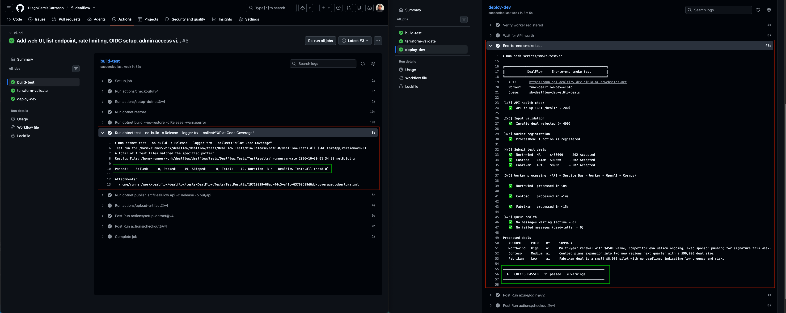</p>

---

## 4. First manual deploy

> **In plain terms:** I deployed by hand first so I'd understand every step before automating it. Azure rejected my first choice of hosting plan, so I switched to the newer one.

I deployed from my laptop (Terraform, then zip deploy with the Azure CLI).

**Problem: the worker's hosting plan was rejected.** The legacy Linux Consumption plan (Y1) couldn't share the resource group's infrastructure with the API's B1 plan:

```text
Requested features 'Dynamic SKU, Linux Worker' not available in resource group
```

**Fix:** moved the worker to **Flex Consumption** (FC1), Microsoft's current serverless Functions plan, with its own deployment-package container:

```diff
- sku_name = "Y1"     # legacy Linux Consumption
+ sku_name = "FC1"    # Flex Consumption
```

After that the API came up and accepted deals.

---

## 5. The incident

> **In plain terms:** deals were being accepted but never finished. The back-office worker was crashing on startup because of a software version mismatch. The inbox held every deal safely, and once fixed, both waiting deals were processed with nothing lost.

Deals were accepted (`202`) but never processed. Over two days I triaged it from queue metrics, the function list, and host logs; reproduced the worker startup locally; and found a `TypeLoadException` caused by an Application Insights SDK major-version conflict. Service Bus held the messages throughout, and both deals were processed exactly once after recovery.

<br>

**Figure 2 · Crash loop and recovery in the host logs**<br>
492 "Exceeded language worker restart retry count" messages on Oct 6; on Oct 8 the host starts and both deals are processed.

<p align="center">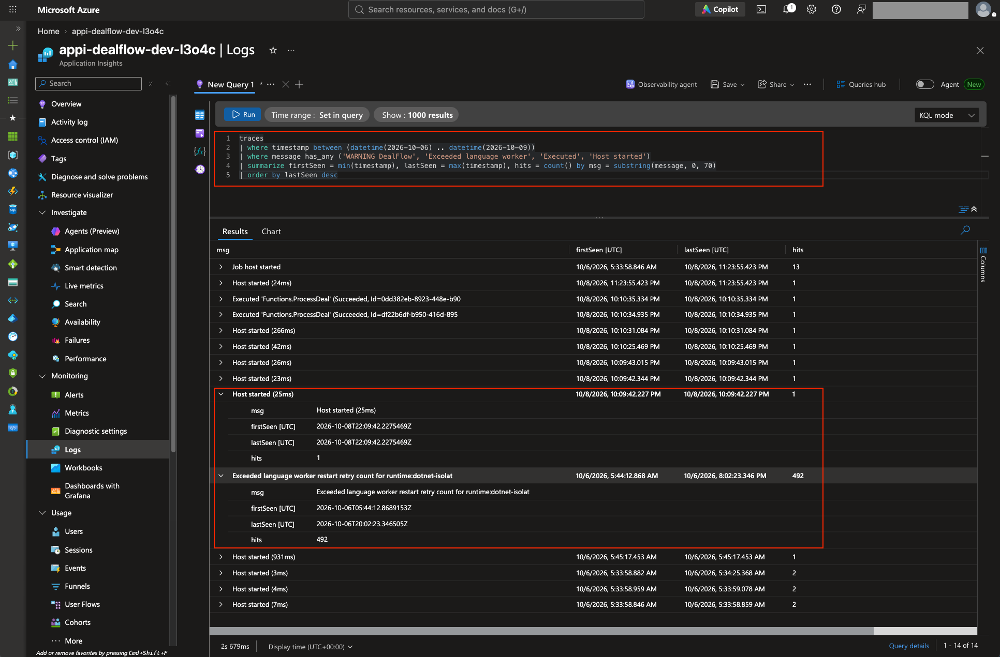</p>

<br>

Full write-up: **[Postmortem: worker crash loop](postmortem-worker-crash-loop.md)**.

---

## 6. Understand and verify

> **In plain terms:** before adding features, I proved each part works and checked every setting in Azure.

- Traced the full request path and the Azure OpenAI pipeline end to end.
- Wrote `scripts/smoke-test.sh`: health, validation, worker registration, three real deals through the whole pipeline, and queue health.

<br>

**Figure 3 · Healthy scale from zero**<br>
The worker was idle (scaled to zero). A deal arrives, the host starts, and the deal is processed about 4 seconds later.

<p align="center">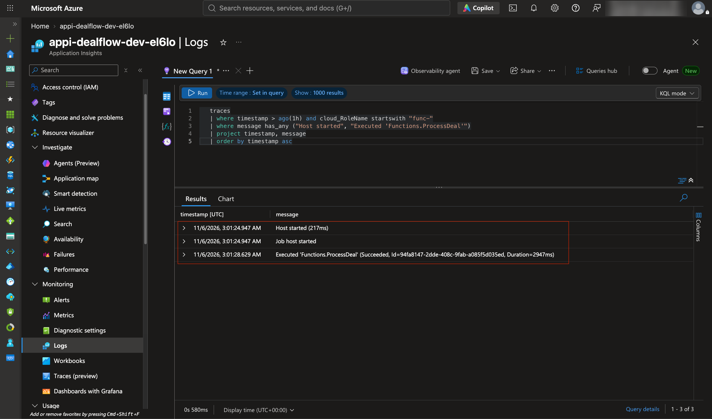</p>

<br>

### Where each piece lives in Azure

**Figure 4 · Worker invocations**<br>
Every `ProcessDeal` run succeeded: 4 successes, 0 errors.

<p align="center">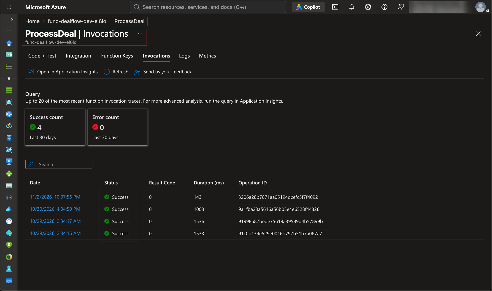</p>

<br>

**Figure 5 · The queue is empty**<br>
Service Bus Explorer: nothing waiting and nothing dead-lettered, so every deal was picked up and processed.

<p align="center">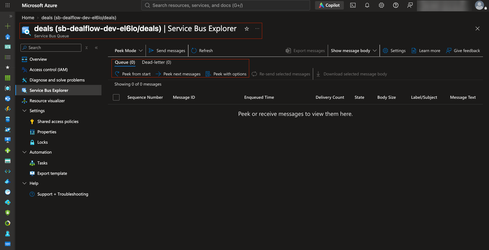</p>

<br>

**Figure 6 · Queue settings**<br>
Duplicate detection on, max delivery count 5, and all message counts at 0.

<p align="center">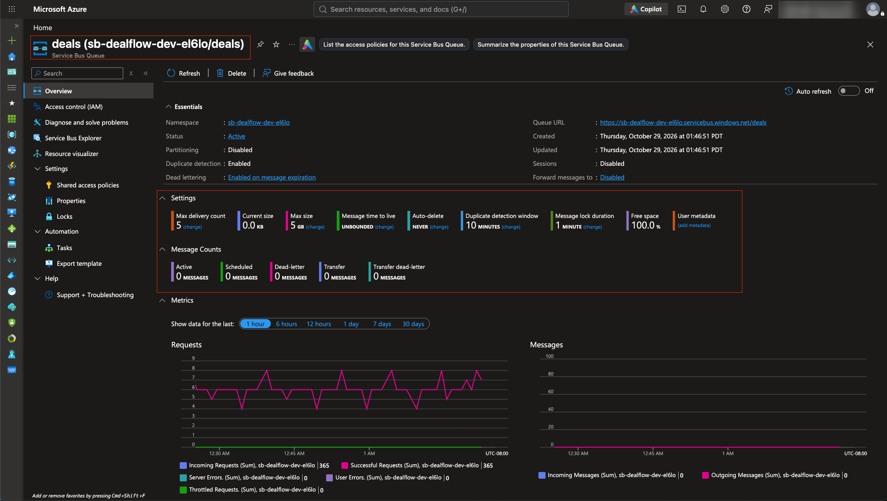</p>

<br>

**Figure 7 · No keys on Service Bus**<br>
Local (key) authentication is disabled; only Microsoft Entra ID identities can connect.

<p align="center">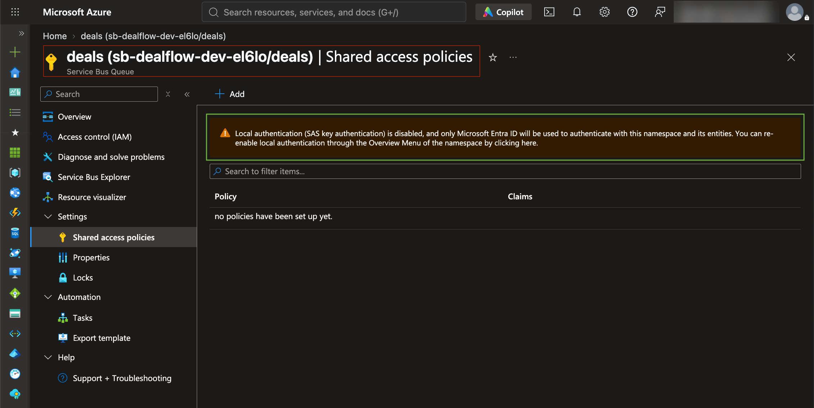</p>

<br>

**Figure 8 · A processed deal in Cosmos DB**<br>
The stored document: the original fields plus `priority`, `summary`, and `enrichedBy: "ai"`.

<p align="center">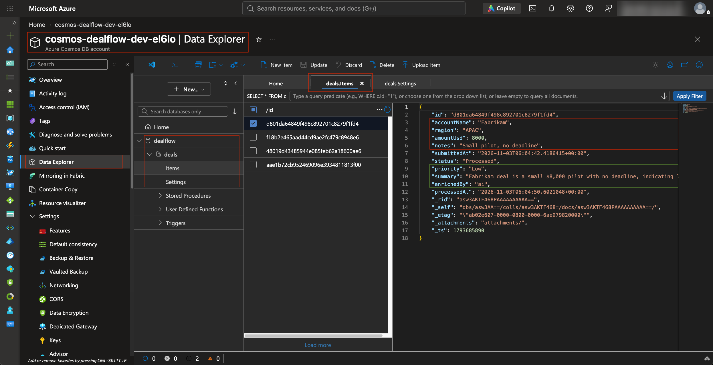</p>

<br>

**Figure 9 · The Azure OpenAI deployment**<br>
Deployment `chat` runs gpt-4.1-mini (version 2025-04-14), Global Standard, 10K tokens per minute.

<p align="center">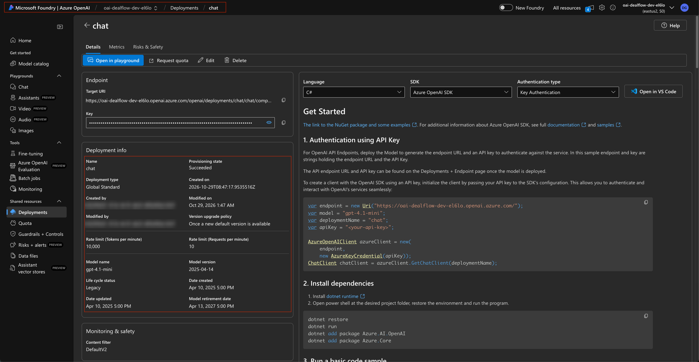</p>

<br>

**Figure 10 · The AI on/off switch**<br>
The `AiEnrichment` feature flag in App Configuration. Turning it off makes the worker use rules instead, with no redeploy.

<p align="center">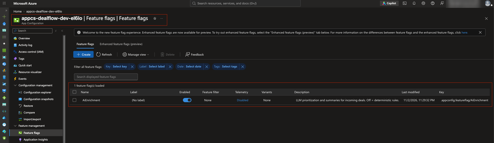</p>

<br>

**Figure 11 · The worker's managed identity**<br>
The worker has its own Azure identity, so it needs no stored password to reach other services.

<p align="center">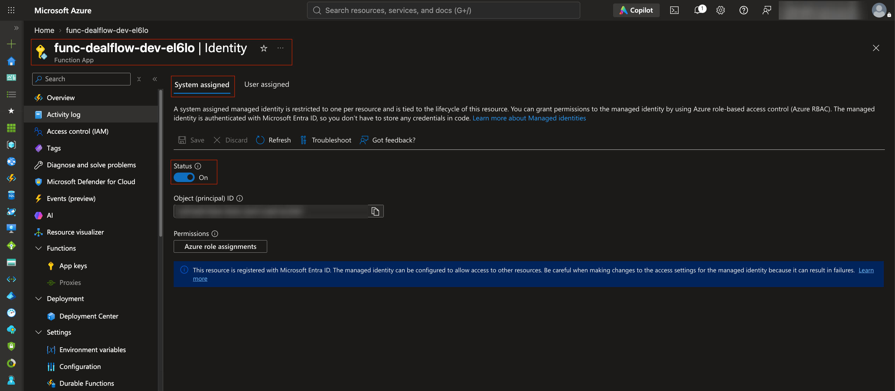</p>

<br>

**Figure 12 · Least-privilege access to Azure OpenAI**<br>
The worker's identity has only *Cognitive Services OpenAI User* on this one resource.

<p align="center">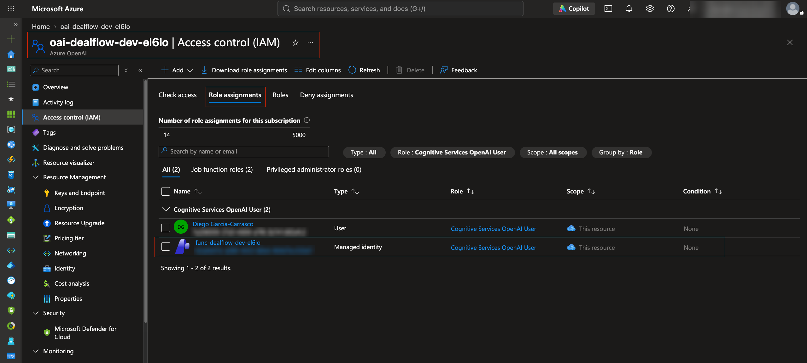</p>

<br>

**Figure 13 · One deal, end to end**<br>
A single trace: `POST /deals` (31 ms) → worker invocation → Cosmos lookups → token → Azure OpenAI call (1.3 s).

<p align="center">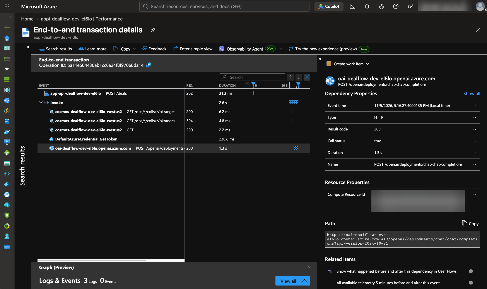</p>

<br>

**Figure 14 · The whole system map**<br>
Application Insights draws every component and call. The red edges are expected noise: managed-identity token probes, and Cosmos `404`s while a deal is still being processed.

<p align="center">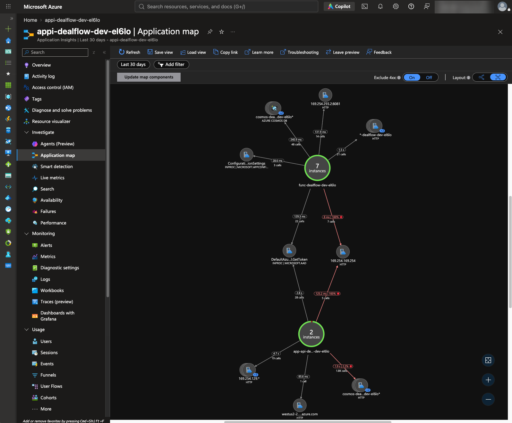</p>

---

## 7. CI/CD with OIDC

> **In plain terms:** I deleted everything and had GitHub rebuild it automatically from code. Five problems came up along the way; each one is listed with its fix.

I destroyed the environment and rebuilt it from scratch through GitHub Actions to prove the pipeline could stand it up alone.

- `scripts/setup-github-oidc.sh` creates an app registration trusted only by this repo's `dev` environment (a federated credential), so the pipeline has **no stored password**.
- The workflow: build and test → Terraform validate → `terraform apply` → deploy API and worker → verify the worker registered → end-to-end smoke test.

<br>

**Figure 15 · Passwordless sign-in for GitHub**<br>
The federated credential: Azure trusts only this repository's `dev` environment. There are 0 client secrets.

<p align="center">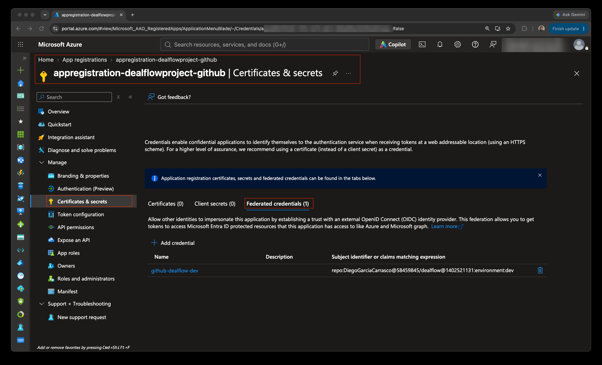</p>

<br>

**Figure 16 · Terraform builds the environment**<br>
The pipeline's `terraform apply`: 26 resources created from code.

<p align="center">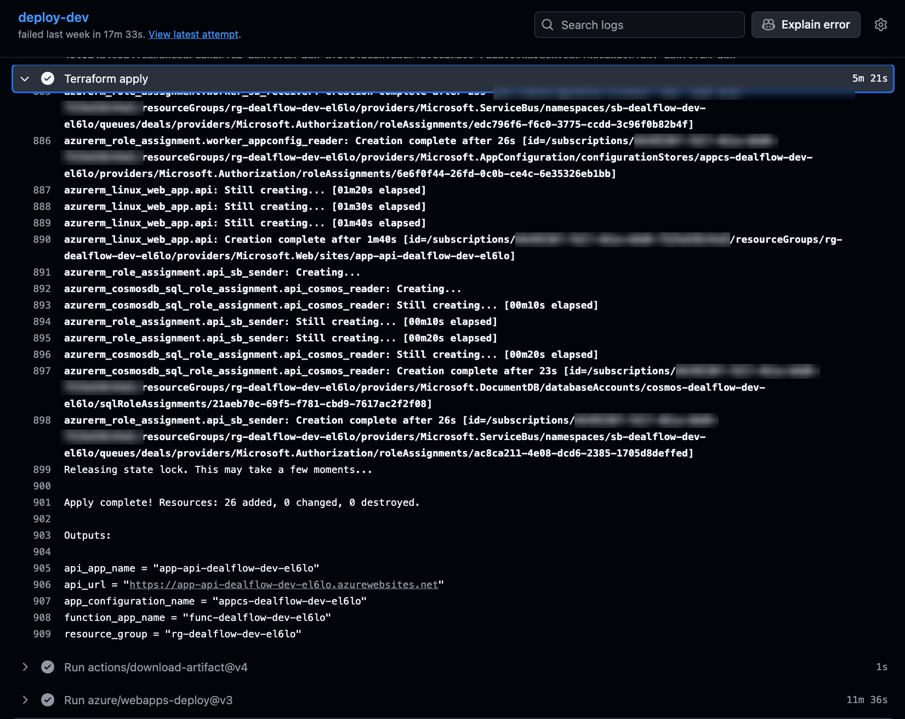</p>

<br>

### Problems fixed along the way

| Failure | Cause | Fix |
|---|---|---|
| `403 AuthorizationPermissionMismatch` reading Terraform state | Sign-in worked, but the pipeline identity had no **data-plane** role on the state storage (Contributor doesn't cover blob data) | Granted *Storage Blob Data Contributor* on the state account |
| `Cannot find required .azurefunctions directory` | `actions/upload-artifact` skips hidden folders, so the Functions metadata never reached the deploy job | `include-hidden-files: true` |
| `state blob is already locked` | A re-run and a new push overlapped on the same state | `concurrency: deploy-dev` so runs queue |
| `409 RoleAssignmentExists` | Roles I'd granted by hand collided with the same roles now defined in Terraform | Removed the manual ones; my portal access now lives in `infra/admin-access.tf` |
| `Request blocked by Auth … readMetadata` in Data Explorer | A rebuild deletes per-resource roles, and Owner isn't enough with key auth off | Same `admin-access.tf`, so access is reproducible |

<br>

**Figure 17 · Problem: no permission to read Terraform state**<br>
The pipeline signed in, but couldn't read the state file: a missing data-plane role.

<p align="center">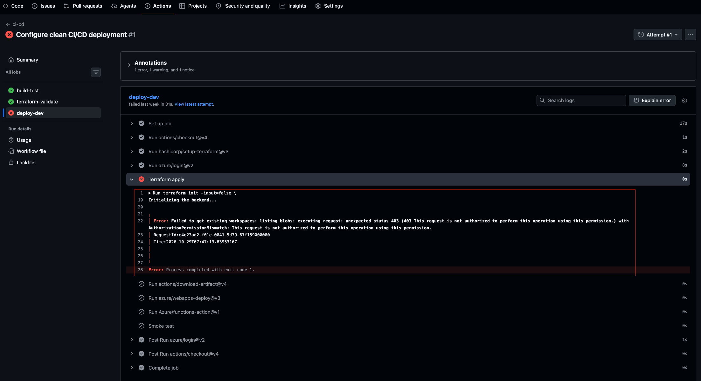</p>

<br>

**Figure 18 · Problem: worker package missing its metadata**<br>
The upload step dropped the hidden `.azurefunctions` folder, so Azure rejected the worker package.

<p align="center">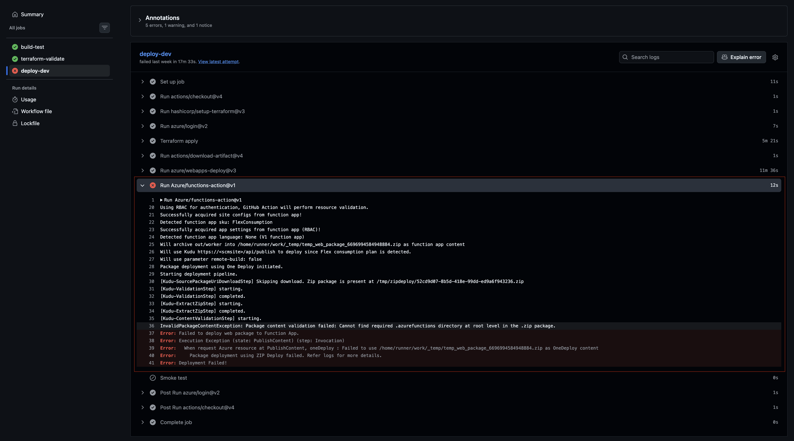</p>

<br>

**Figure 19 · Problem: locked out of my own database view**<br>
After the rebuild, the portal's Data Explorer was blocked because my per-resource roles were gone. Now granted by `admin-access.tf` on every deploy.

<p align="center">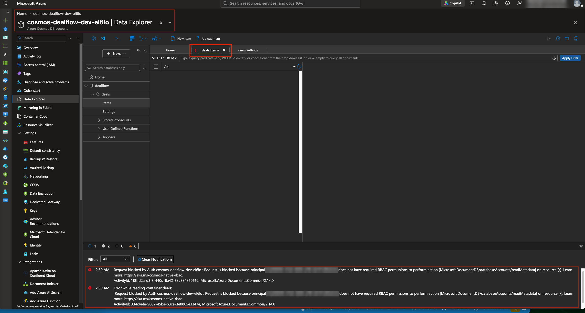</p>

<br>

### The green run

**Figure 20 · Every job passing**<br>
build-test, terraform-validate, and deploy-dev all green.

<p align="center">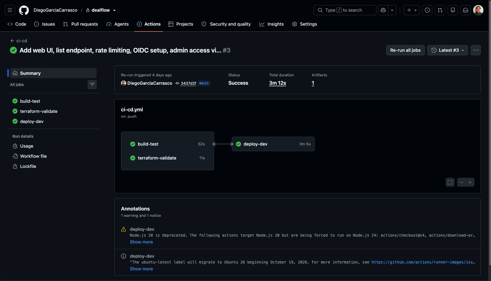</p>

<br>

**Figure 21 · Deploy steps, including the safety checks**<br>
After deploying, the pipeline confirms the worker registered `ProcessDeal` and the API reports healthy, before the smoke test runs.

<p align="center">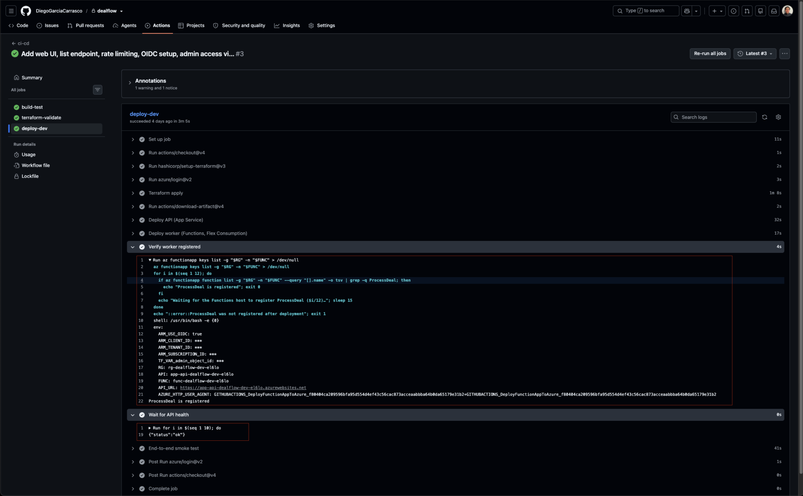</p>

<br>

**Figure 22 · Everything the pipeline created**<br>
The resource group after the rebuild: 12 resources, all tagged `managed_by: terraform`.

<p align="center">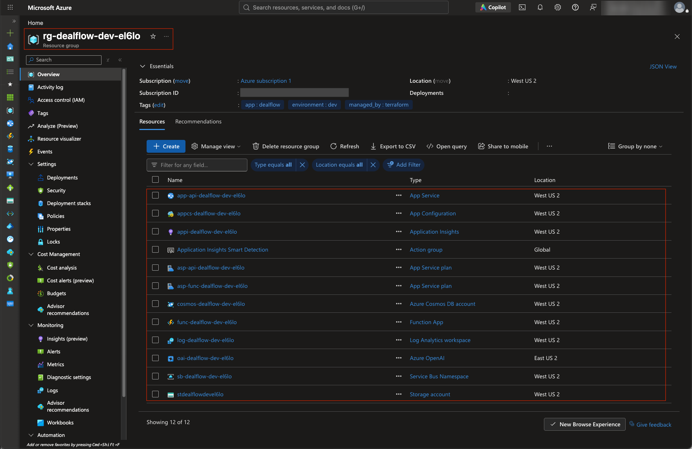</p>

---

## 8. Web UI

> **In plain terms:** I added a simple web page so anyone can try the system and watch a deal move through each step.

A single static page served by the API from `wwwroot/` (same origin, so no CORS and no extra Azure resource). It makes the async design visible: a live pipeline strip, the deal as entered next to what Azure OpenAI added, and a history of processed deals.

Backend changes it needed: a `GET /deals?limit=N` endpoint (a capped, parameterized Cosmos query; its cross-partition cost is noted in ADR 0002) and a per-IP rate limit on `POST /deals`, because a public form can be spammed and each deal costs an OpenAI call. Three integration tests cover the page, the list ordering, and the `429` path.

<br>

**Figure 23 · Waiting on the worker**<br>
The API accepted the deal in 228 ms and queued it; the worker is still processing.

<p align="center">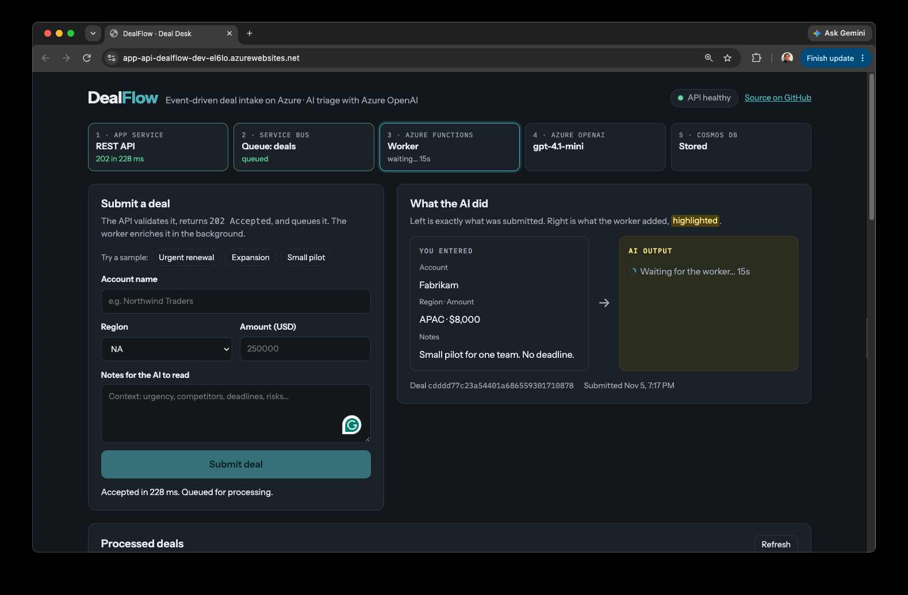</p>

<br>

**Figure 24 · The result: entered vs. AI output**<br>
Left: what was typed. Right: the priority and summary Azure OpenAI added.

<p align="center">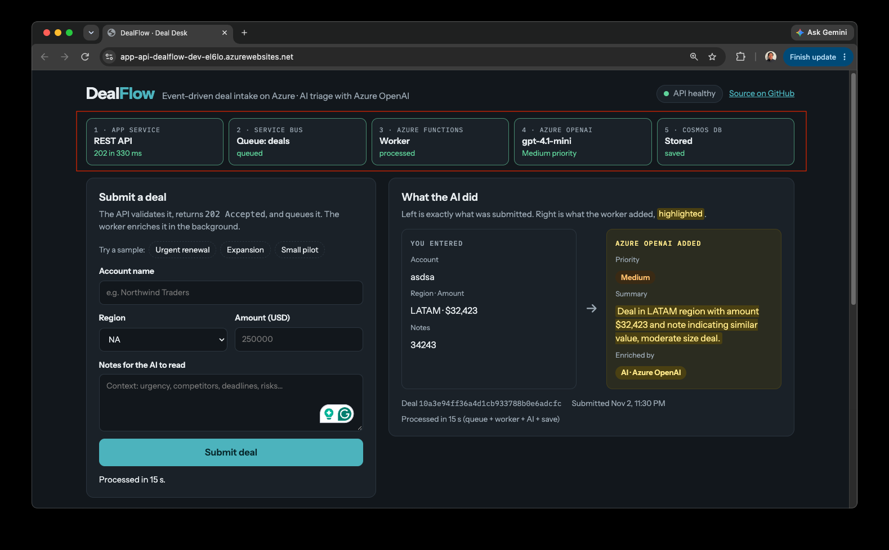</p>

<br>

**Figure 25 · Deal history**<br>
Each deal shows whether the AI or the rules fallback handled it, and how long processing took.

<p align="center">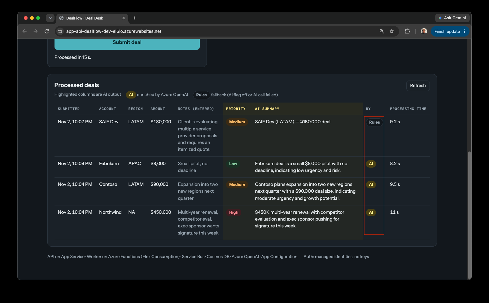</p>

<br>

**Figure 26 · Server-side validation**<br>
An empty form is rejected by the API (`400`), and each field shows its error.

<p align="center">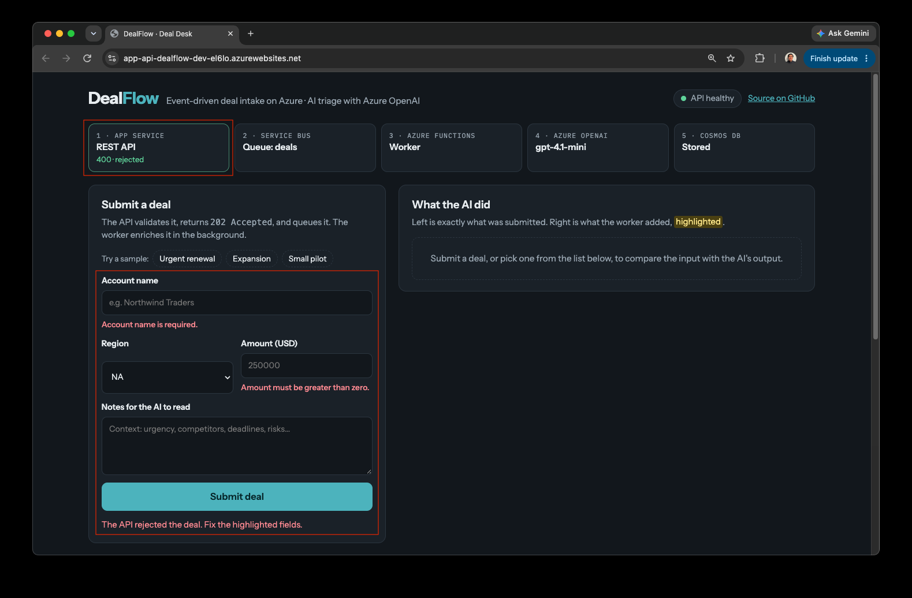</p>

<br>

**Figure 27 · Rate limit**<br>
Twelve quick submissions: the API accepts up to 10 per minute per IP, then answers `429 Too Many Requests`.

<p align="center">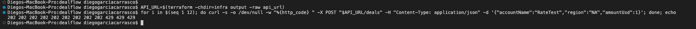</p>

<br>

**Figure 28 · The list endpoint**<br>
`GET /deals?limit=2` returns the two newest processed deals as JSON.

<p align="center">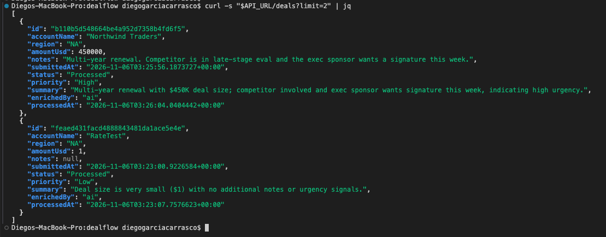</p>

---

## 9. Public-repo hardening

> **In plain terms:** before making the code public, I made sure no account IDs or passwords could leak, and that nobody else can deploy to my Azure account.

- Azure IDs moved to GitHub **secrets**, so they're masked as `***` in public Actions logs.
- My personal admin ID lives in a gitignored `infra/admin.auto.tfvars` locally and an `ADMIN_OBJECT_ID` secret in CI; only an `.example` is committed.
- The `dev` environment deploys only from `main`, so forks and pull requests can never reach Azure.
- Old workflow runs with unmasked IDs were deleted before publishing.

<br>

**Figure 29 · Only `main` can deploy**<br>
The `dev` environment accepts deployments from the `main` branch only.

<p align="center">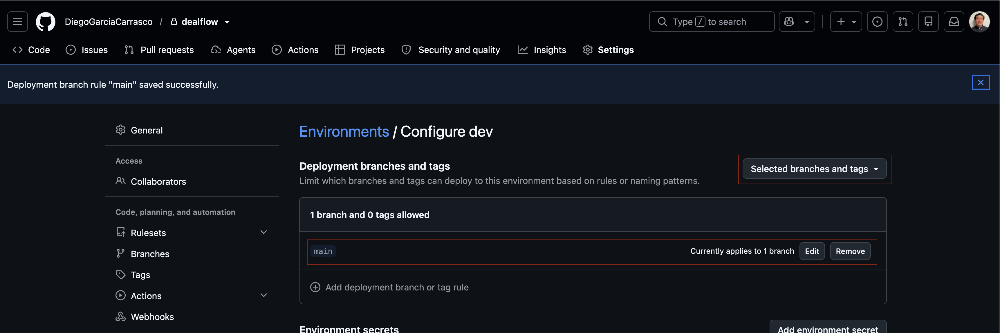</p>

---

## 10. The result

> **In plain terms:** a working, secure, monitored cloud service, rebuilt automatically from code, with a real outage handled and documented.

- **Architecture:** REST API → Service Bus → Azure Functions → Azure OpenAI → Cosmos DB, with App Configuration flags and Application Insights telemetry.
- **Reliability:** idempotent at-least-once processing, dead-lettering, graceful AI fallback, non-fatal config startup, verified deployments.
- **Security:** no keys anywhere, least-privilege managed identities, OIDC CI/CD, rate limiting, XSS-safe rendering, validated model output.
- **Operations:** a real live-site incident, diagnosed and written up.

How I used AI tools while building this: see [the README](../README.md#how-i-used-ai-tools).
