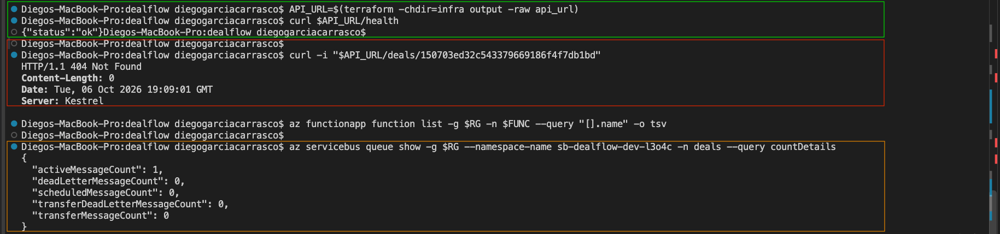
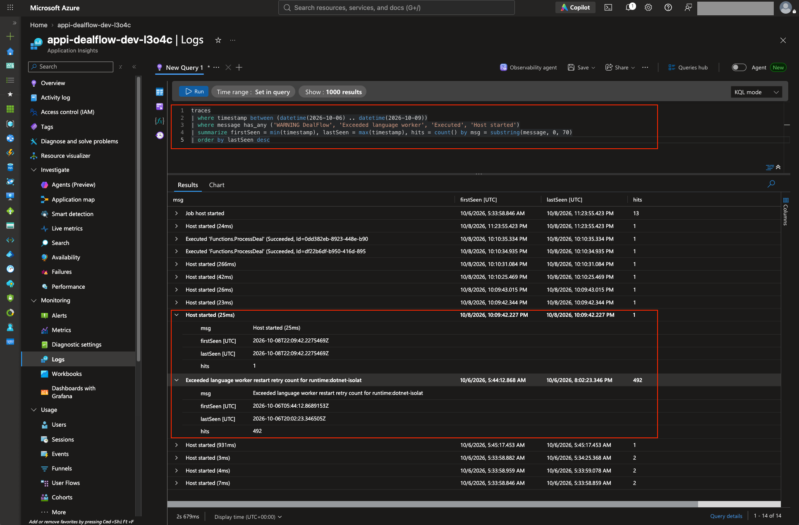
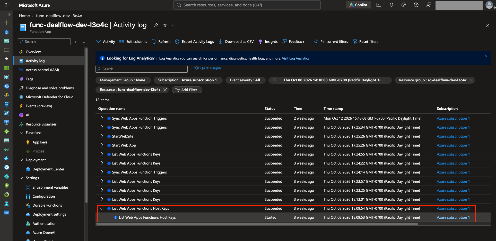

# Postmortem: deals accepted but never processed (worker crash loop)

**Dates:** 2026-10-06 → 2026-10-08 (dev environment)  ·  **Impact:** 2 deals accepted (`202`) but not processed for ~2 days. No data lost.

## Summary
The Azure Functions worker crashed at startup on every attempt because of a NuGet major-version conflict between the Application Insights SDK and the Functions Application Insights bridge. The API kept accepting deals and Service Bus held them. After the version was pinned and redeployed, the worker still didn't start until a fresh host instance was forced, because Flex Consumption had scaled to zero and the trigger had never synced.

## Symptoms
- `POST /deals` returned `202 Accepted`, but `GET /deals/{id}` kept returning `404`.
- Service Bus queue `deals`: `activeMessageCount` growing, `deadLetterMessageCount` 0, so messages were never even attempted.
- `az functionapp function list` returned nothing: the Functions host had not registered `ProcessDeal`.
- `syncfunctiontriggers` failed with `InternalServerError from host runtime`.



## Timeline (UTC)
| Time | Event |
|---|---|
| Oct 6 05:44 | First worker deploy. Host logs start: *"Exceeded language worker restart retry count for runtime:dotnet-isolated"* |
| Oct 6 05:44 → 20:02 | Same message **492 times**: the .NET worker process crashes at startup on every restart |
| Oct 6 (afternoon) | Root cause found and fixed (below). Redeploy reports "Deployment was successful", but `syncfunctiontriggers` still fails and no instance starts |
| Oct 6 20:02 → Oct 8 22:09 | No host activity: Flex Consumption had scaled to zero and nothing woke it, because the trigger was never synced |
| Oct 8 22:09:53 | Opening the Function App in the portal (a *List host keys* call) starts a fresh instance with the fixed package |
| Oct 8 22:10:34–35 | `Executed 'Functions.ProcessDeal' (Succeeded)` ×2: both waiting deals processed and enriched by Azure OpenAI |

**Evidence**





## Investigation
1. **Is the API the problem?** No: `/health` was `200` and `POST` returned `202`, so intake worked.
2. **Is the worker failing on messages?** No: dead-letter count was 0 and delivery count 0, so nothing had consumed them.
3. **Is the worker running at all?** No: the function list was empty and the trigger sync failed.
4. **Why not?** Host logs (with a 2-hour window and no severity filter) showed the language worker restart loop. The `exceptions` table was empty, because the crash happened *while* telemetry was being configured.
5. **Reproduced locally** by running the published `DealFlow.Worker.dll` directly, which printed the real exception.

## Root cause
```
System.TypeLoadException: Could not load type
'Microsoft.ApplicationInsights.Extensibility.ITelemetryInitializer'
from assembly 'Microsoft.ApplicationInsights, Version=3.1.2'
   at ...ConfigureFunctionsApplicationInsights(...)
```

`Microsoft.ApplicationInsights.WorkerService` had been added without a version pin, so NuGet resolved **3.1.2**. The Functions bridge `Microsoft.Azure.Functions.Worker.ApplicationInsights` is built against **2.x**, which still has `ITelemetryInitializer`; 3.x removed it. The code compiled (our code never touches the type) and all unit tests passed (they don't run Functions startup), so it only failed at runtime in Azure.

## Fixes
1. **Pinned** `Microsoft.ApplicationInsights.WorkerService` to `2.23.0`. This was the actual fix.
2. **Made App Configuration non-fatal at startup.** If the feature-flag store is unreachable, the worker logs a warning and starts with AI enrichment off (rules fallback) instead of crash-looping. A non-critical dependency must never stop message processing.
3. **Post-deploy verification in CI/CD.** The pipeline wakes the host and fails the deploy unless `ProcessDeal` is registered, then runs an end-to-end smoke test.

## What went well
- Service Bus held both messages for two days. Once the worker recovered they were processed exactly once (idempotent processor), so **no deals were lost**.
- Queue metrics (active vs dead-letter) immediately placed the fault on the consumer side.

## Lessons
- "Deployment successful" ≠ "service healthy". Verify what users depend on: trigger registered, message processed.
- Pin major versions of SDKs that other packages depend on.
- A crash *during* telemetry setup is invisible to telemetry. Check host logs, and reproduce startup locally.
- On Flex Consumption, a failed trigger sync means nothing watches the queue. Wake the host after deploying.
